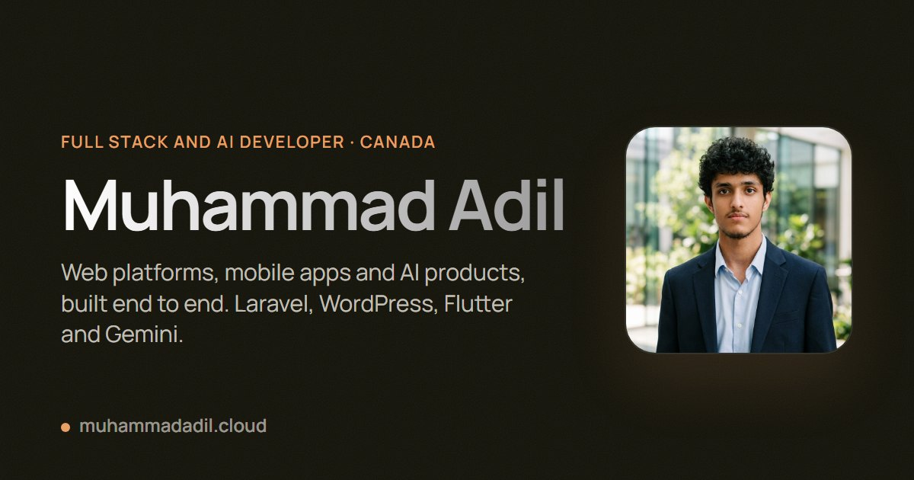

# Muhammad Adil, developer portfolio

**Live site:** [muhammadadil.cloud](https://muhammadadil.cloud)



The portfolio of Muhammad Adil, a full stack and AI developer in Canada. Nine pages, prerendered to static HTML,
hydrated with React, designed around one offer (web, mobile and AI products built end to end) and one action
(start a conversation).

## Pages

| URL | Purpose |
|---|---|
| `/` | Home: hero, selected work, services, process, about, proof, FAQ, contact call to action |
| `/projects/` | Three case studies and nine live client projects with roles |
| `/projects/knowwhere/`, `/projects/bc-scrap-cars/`, `/projects/sb-traworld/` | Case studies |
| `/services/` | Five services with proof, process, pricing model, FAQ |
| `/about/` | Entity page: facts, timeline, principles, stack, profiles |
| `/contact/` | Direct lines and a validated contact form (FormSubmit) |
| `/privacy/` | Short privacy note (not indexed) |
| `/404.html` | Branded not found page (served by `.htaccess`) |

## How it is built

- **React 19 + Vite 8 + Tailwind CSS 4.** One HTML entry per page (`vite.config.js`), no client side router.
- **Prerendered.** `npm run build` runs `vite build`, then `scripts/prerender.mjs` renders every route with
  `react-dom/server` and writes the HTML into `dist/`. Crawlers and AI assistants get full content without JavaScript;
  the browser hydrates the same markup.
- **SEO data in one place.** `src/data/site.js` holds the identity used by every page, `src/seo/schema.js` builds the
  JSON-LD graph (Person, ProfilePage, WebSite, ProfessionalService, FAQPage, BreadcrumbList, SoftwareApplication) and
  `src/seo/head.js` builds the head tags.
- **Design system.** Manrope (self hosted), one accent colour, flat backgrounds, Phosphor icons inlined, scroll reveals
  with `IntersectionObserver`, no animation library.
- **Hosting.** Hostinger, continuous deployment from `main`. `public/.htaccess` redirects www to the apex, strips
  `index.html`, sets the 404 page and cache headers.

## Getting started

```bash
npm install
npm run dev      # http://localhost:5173, every page under its own path
npm run lint
npm run build    # dist/ with prerendered HTML
npm run preview  # serve dist/ locally
```

Requires Node.js 20.19 or newer.

## Updating content

- **Identity, links, stats:** `src/data/site.js`
- **Client projects:** `src/data/projects.js` (screenshots in `public/images/projects/spotlight/`)
- **Case studies:** `src/data/caseStudies.js`; a new case study also needs an HTML entry under `projects/<slug>/`,
  an entry in `vite.config.js`, `src/entries/<slug>.jsx` and a line in `public/sitemap.xml`
- **Services, process:** `src/data/services.js`
- **FAQ:** `src/data/faq.js`
- **Skills, timeline:** `src/data/skills.js`
- **Resume:** edit `cv/cv.html`, print to PDF, copy to `public/files/adil-cv.pdf`
- **AI assistants summary:** `public/llms.txt`

## SEO files

`public/robots.txt`, `public/sitemap.xml`, `public/llms.txt`, `public/.htaccess`, `public/site.webmanifest`.
The audit and plan behind this build are in `docs/SEO_AUDIT_2026-10-12.md`.

## License

Copyright Muhammad Adil. All rights reserved. The source is shared for reference. Please do not copy the design
or content without permission.
